# GiMap

Ultimative map for your Vintage Story

## Modes

At the moment the mod has 12 map modes, plus map notes

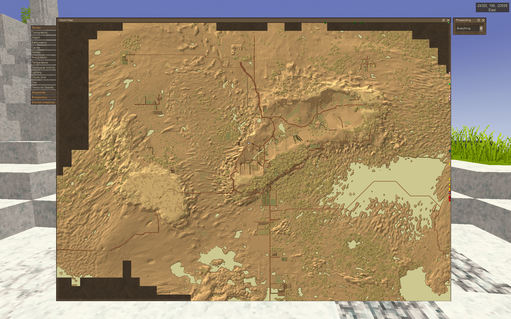

### Topographic

Surface type detection mode. Displays soil, sand, gravel, rock, and roads.
Contour lines are drawn over the map, every Nth one is an index contour with a height label, and peaks are marked with their height.

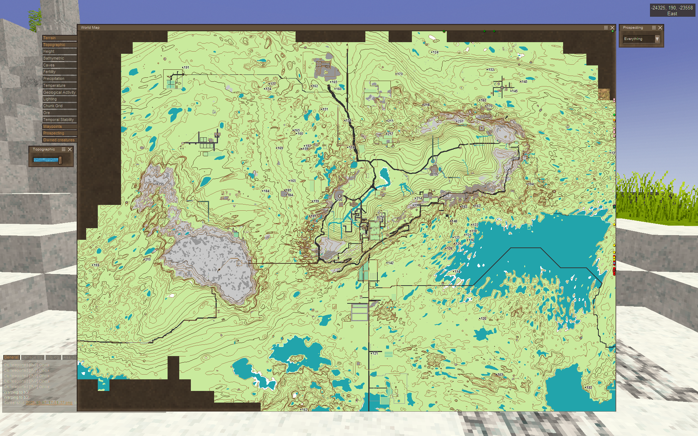

### Height

Altitude display mode. Works for both surface and underwater.

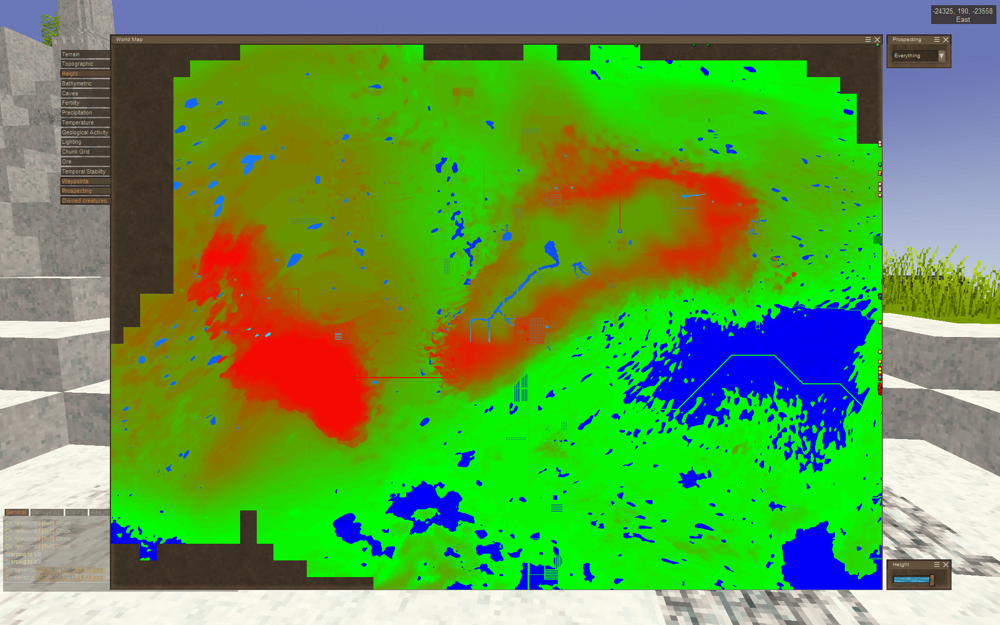

### Bathymetric

Displays the depth of water bodies, measured from the water surface (ice included), as a shallow → medium → deep gradient.
Land is drawn in a single color. Isobaths, depth labels on index isobaths and the deepest points help to find a place for a harbour or a dive.

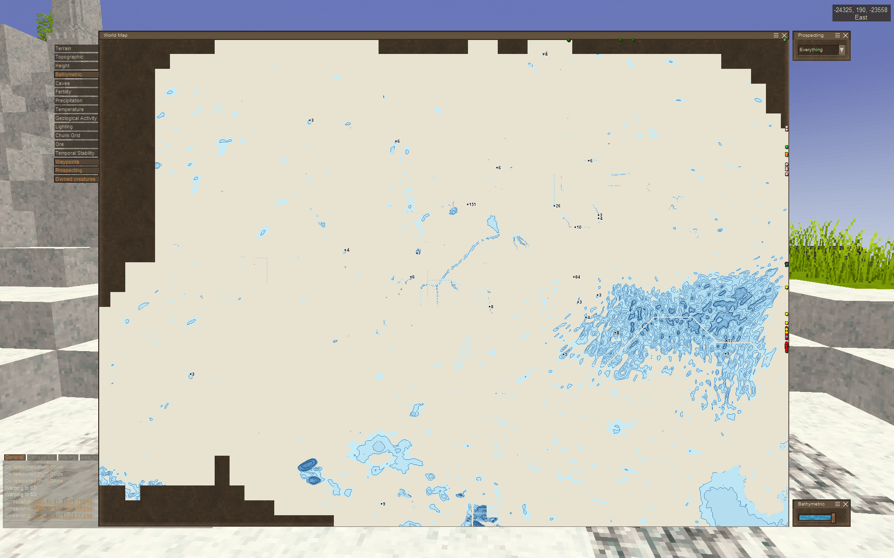

### Caves

Displays cave floors in layers of 32 blocks (layer 1 is the deepest).
Pick a layer with the slider, or turn on "Follow player" and the layer will follow your height.
Floors are colored by material: stone, soil, sand, gravel, ore, lava, ice and structures.

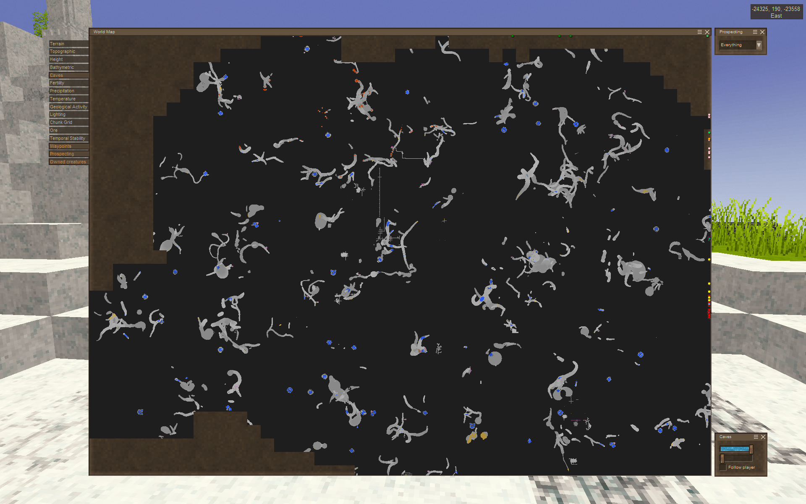

### Fertility

Displays soil fertility and is helpful when planning a garden.
Forest floor is shown hatched as low fertility. Snow is skipped, so fertile soil under it is still visible (hatched white).

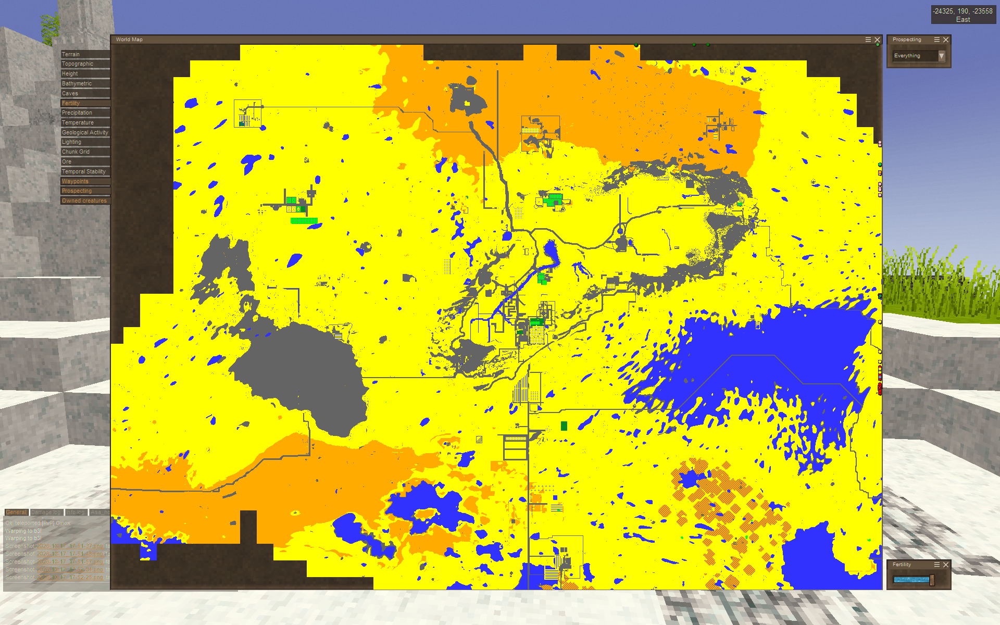

### Precipitation

Displays the average annual precipitation level.

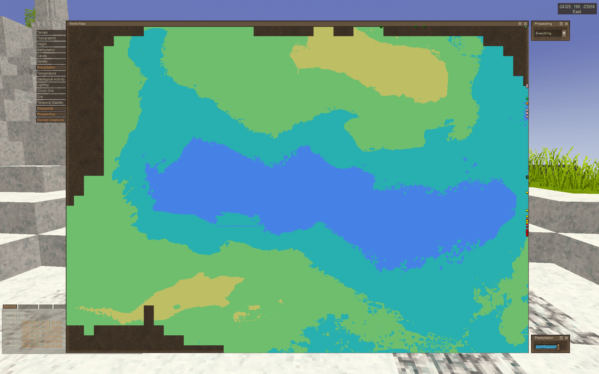

### Temperature

Displays the average annual temperature level.

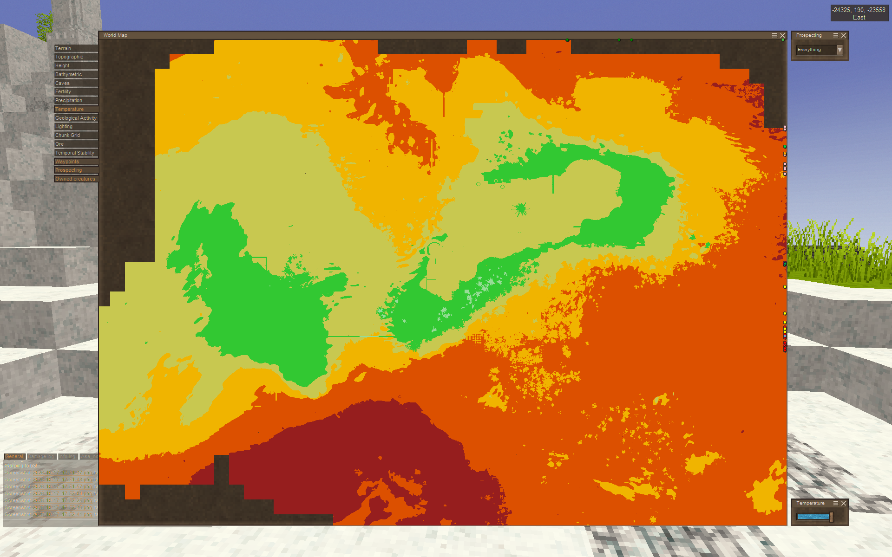

### Geological activity

Displays the level of geological activity.
Areas with high values will have geothermal vents on the surface and lava lakes underground.

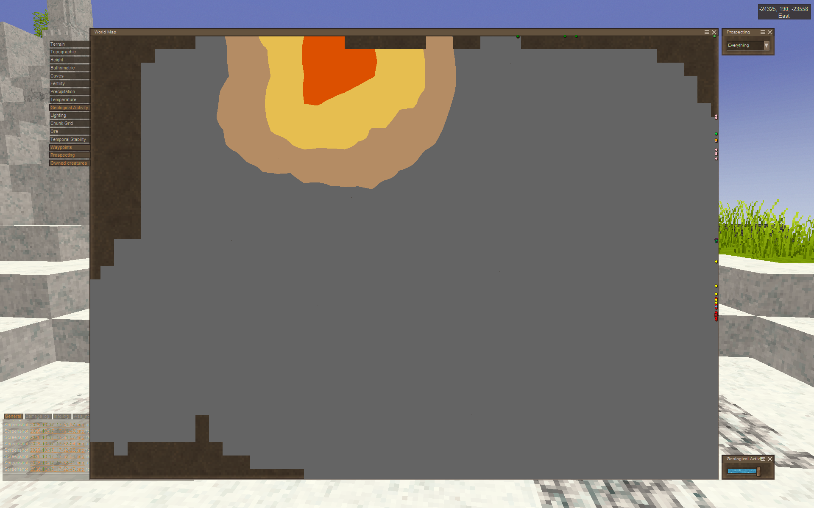

### Lighting

Displays the level of artificial lighting. Useful for illuminating settlements and identifying dark areas.

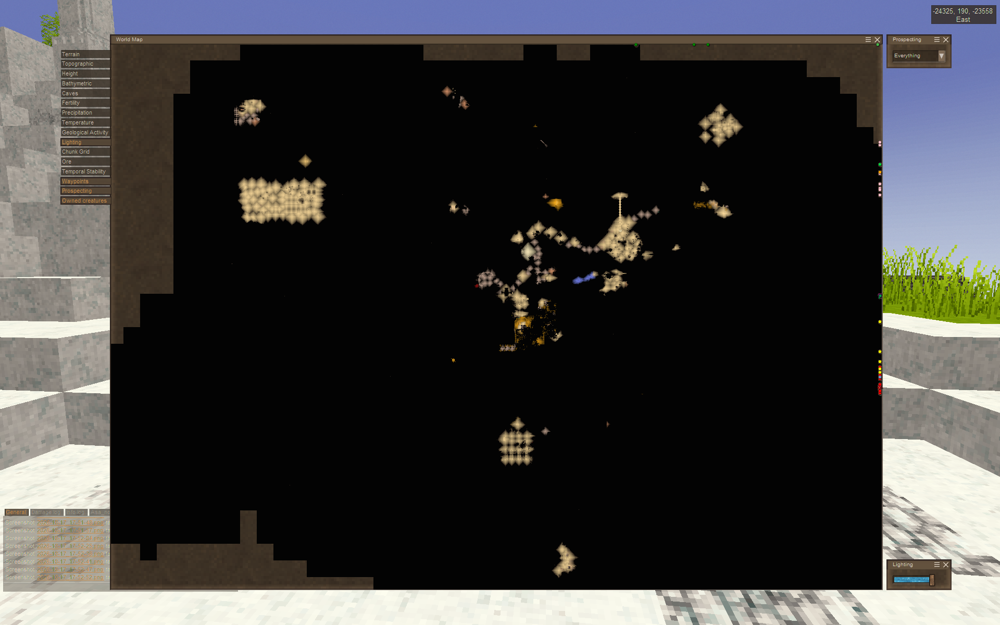

### Chunk grid

Brutal chunk grid. x32, x16 and x8.

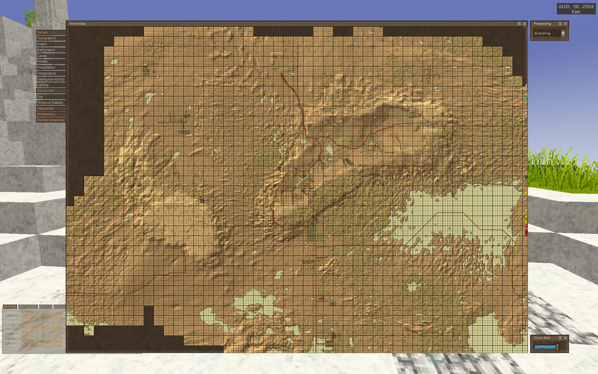

### Ore

_Since 1.6.0 ore map is disabled by default. To use it, enable it in the settings_

Displays ore deposits. Each column remembers up to 4 ore groups, so you can choose which ores to show in the layer dialog
without regenerating the map. Presets (copper, bronze, iron, coal, precious metals, clay, marble, etc.) toggle several ores at once.

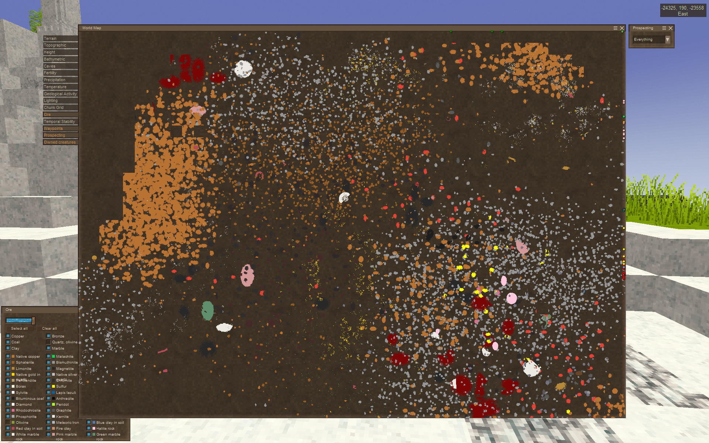

### Temporal stability

Build your house so that your friend's room is in the unstable zone.

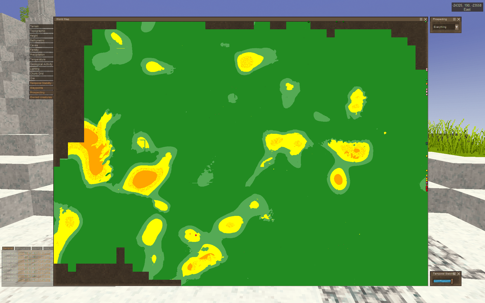

### Butterflies

Pick a butterfly in the layer dialog, and the map highlights the chunks where it may spawn:
the climate (temperature, rainfall, forest cover) and height of at least one place in the chunk match its spawn conditions.
Switching the butterfly does not regenerate the map.

## Mix modes

Why? Yes.


## Map notes

Draw right on the full-screen map: text, lines, circles, rectangles and polygons/polylines.
Notes can show their length, radius, area, perimeter or dimensions, have a color, line style
(solid, double, triple, dashed, dash-dot, wavy, saw), line width, font size and fill.

To add a note, right-click the map → "Add note" → pick a type, place the points with clicks and fill in the editor.
Right-click an existing note to edit or delete it.

**Notes are stored in vanilla waypoints.** Each note is a normal waypoint with its data in the title,
so no server-side mod is needed:

- notes work on any server, even one without GiMap;
- notes are saved by the server together with your waypoints, so when you play on a server from two PCs,
  the notes are synchronized between them like any other waypoint;
- notes of other group members are shown too, but only their author can change them.

GiMap hides the vanilla icon of such waypoints, so they do not clutter the map.
Players without the mod will see these waypoints as regular ones with an unusual title.

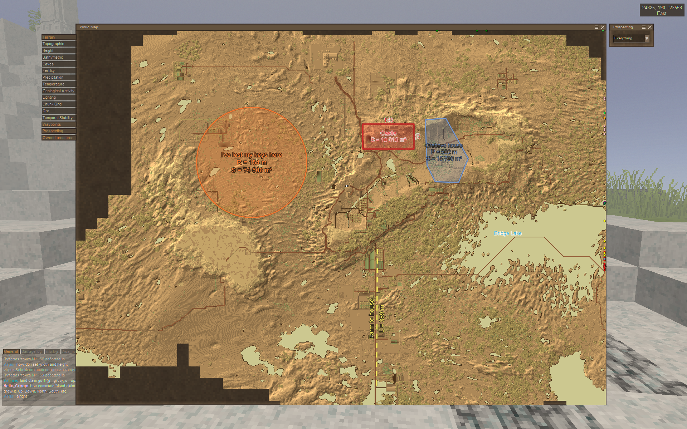

## Context menu

Right-click on the world map opens a context menu:

- **Add waypoint** opens the vanilla waypoint dialog;
- **Add note** creates a map note (see above);
- **Teleport here** teleports you to that point on the surface (only with the `tp` privilege).

The vanilla "Modify waypoint" dialog also gets a **Teleport here** button that teleports you to the exact position of the waypoint.

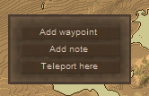

## Map buttons

The menu in the title bar of the world map has extra buttons:

- **Expand map / Default size** stretches the full-screen map to the whole window and back;
- **Map properties** opens the map properties dialog.

The map can also be zoomed out further than vanilla allows (down to 1/16 by default, see settings).
On low zoom the maps are drawn with merged LOD tiles, so they stay fast.

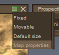

## Map properties

Shows how much disk space the maps of the current world take, per mode (including the vanilla terrain map).
Any map can be deleted to free space or to redraw it from scratch, or all at once with "Delete all".

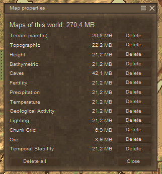

## Settings

GiMap has its own tab in the in-game settings:

- layer opacity and minimum map zoom;
- switches for every map mode (take effect after rejoining the world);
- topographic: contour lines, contour interval, index contour frequency, height labels and the zoom from which labels are shown;
- bathymetric: isobaths, their interval, depth labels and deepest point labels;
- fertility: forest floor hatching and soil under snow;
- **Reset settings** returns everything to defaults.

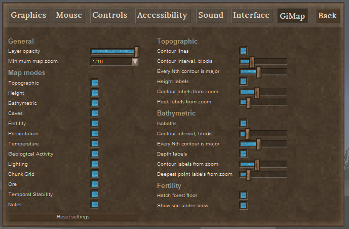

## Config

All settings are stored in _\VintagestoryData\ModConfig\GiMapConfig.json_. Most of them can be changed in the settings tab,
the rest (colors, ore lists) are edited in the file.

All colors are defined in HEX format (`#rrggbb` or `#rrggbbaa`), ex.
```json
"TopographicMode": {
    "soilColor": "#c9ea9d",
    "sandColor": "#ffffff",
    "gravelColor": "#c8c8c8",
    "stoneColor": "#969696",
    "waterColor": "#22a4ab",
    "iceColor": "#caedee",
    "snowColor": "#e6e6ff",
    "roadColor": "#323232"
  },
```

You can disable unnecessary modes. To do it, set
```json
"isEnabled": false
```

You can add your own ores from mods or remove unwanted ones.
```json
"game:ore-.*-nativecopper-.*": "#b87333",
"game:ore-.*-malachite-.*": "#0bda51",
"game:ore-.*-cassiterite-.*": "#462a29",
```

Keys use regular expression format. For more information see [that](https://learn.microsoft.com/dotnet/standard/base-types/regular-expressions).

## Credits

I used [Geology Map](https://github.com/carlosganhao/VS-GeologyMap) as an example. I'm not sure if
anything from the original solution remains at this point, but I decided to mention it nonetheless.

[TemporalityMap](https://github.com/kryptokatze/TemporalityMap/)
